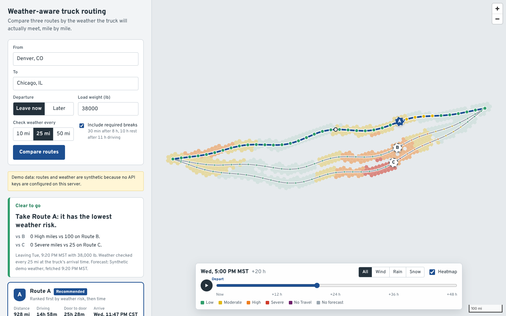

# Weather-aware truck routing

A React + Django app that helps a truck driver choose the safest of three routes, using the
forecast for the hour the truck will actually reach each point, the load weight, and travel time.



*Screenshot from demo mode (synthetic weather, no basemap in the capture environment).*

- **Hosted app:** _add link_
- **Walkthrough (Loom):** _add link_

## What it does

1. The user picks an origin and destination (autocomplete), departure (now or a local time at the
   origin), load weight, sampling interval (10 / 25 / 50 mi) and whether to include required breaks.
2. The backend gets **three distinct truck routes** from HERE Routing v8 (truck mode, with the gross
   weight), filling gaps with pass-through via-point routes when HERE returns fewer.
3. Each route is sampled every N miles. Every checkpoint gets an **ETA from HERE's per-span
   durations**, shifted by **Hours-of-Service stops**, and the Open-Meteo forecast **for that hour**.
4. Each checkpoint is classified with the spec's risk table and load rules; checkpoint levels are
   converted to **level-miles** per route.
5. Routes are ranked (No Travel gate → Severe miles → High miles → average risk → time) and the
   winner comes with a plain-language reason for each comparison.
6. A **leave-later scan** re-scores all routes for departures up to +24 h and suggests a later start
   when it materially lowers risk.
7. The map shows all routes, checkpoints (hover for ETA and readings), HOS stops, and a **corridor
   heatmap with a 0–48 h slider**. Moving the slider never hits the network; it also moves a
   "truck ghost" along each route, showing where each truck would be at that hour.

## Run it locally

```bash
# Backend (Python 3.12+)
cd backend
python -m venv .venv && source .venv/bin/activate
pip install -r requirements-dev.txt
cp .env.example .env            # add HERE_API_KEY for live data; leave empty for demo mode
python manage.py runserver      # http://127.0.0.1:8000

# Frontend (Node 20+)
cd frontend
npm install
npm run dev                     # http://localhost:5173 (proxies /api to :8000)
```

Without a `HERE_API_KEY` the backend runs in **demo mode**: deterministic synthetic routes and moving
storm systems that mimic the live APIs' semantics. The UI says so in a banner. Demo mode keeps the
app and its tests runnable with no keys; it is never mixed with live data.

Tests and lint: `cd backend && pytest && ruff check apps tests`.

## Stack

| Layer | Choice | Why |
|---|---|---|
| Routing + geocoding | **HERE Routing v8** (`transportMode=truck`, `vehicle[grossWeight]`), HERE Geocoding & Search | Truck-legal routing, up to 6 alternatives, per-span durations, predicted traffic for the departure time. OpenRouteService caps alternative routes at 100 km, which rules it out for trucking. |
| Weather | **Open-Meteo** hourly forecast | Free, no key, 16-day hourly forecast, many locations per request. Units are normalised from the response's own `hourly_units`. |
| Backend | Django 5 + DRF, httpx, shapely, h3, timezonefinder | Pure-function domain layer; providers behind interfaces; no database (plans live in the cache). |
| Frontend | React 19 + Vite + TypeScript, MapLibre GL, h3-js, TanStack Query, Zustand | WebGL map with free OpenFreeMap tiles; no map token needed. |
| Cache | Django cache (Redis via `REDIS_URL`, in-memory otherwise) | Weather series, plans, heatmaps and reverse geocodes. |

### Code layout

```
backend/apps/planner/
  domain/      pure logic, no I/O. Most of the unit tests are here.
    risk.py      spec thresholds, load rules, advisories
    geo.py       distances, sampling, midpoint attribution, overlap
    hos.py       Hours-of-Service stops and clock/drive-time mapping
    weather.py   hourly series and how to read them at an arbitrary time
    scoring.py   checkpoint evaluation, level-miles, ranking, worst stretch
  providers/   HERE, Open-Meteo and demo implementations behind small interfaces
  services/    orchestration: routes_service (3 distinct routes), planner, heatmap, weather cache
  api/         DRF views, validation, uniform error envelope
frontend/src/
  components/  TripForm, PlaceInput, Verdict, RouteCard, RiskRibbon, CheckpointTable, MapView, TimeBar
  lib/         API client, formatting, truck-position interpolation
```

## Decisions & assumptions

The spec leaves several things open. Each one below is resolved deliberately, and every one is
covered by tests.

**Risk thresholds.** The table's tiers share endpoints (rain 0.10–0.25 and 0.25–0.50). Bands are
lower-inclusive and upper-exclusive, except where the spec's top tier is written with `>`
(rain `>1.00`, snow `>3.0`), so the boundary value itself is Severe:

| | Low | Moderate | High | Severe | No Travel |
|---|---|---|---|---|---|
| Wind (mph) | < 25 | 25 – <35 | 35 – <45 | 45 – <55 | ≥ 55 |
| Rain (in/hr) | < 0.10 | 0.10 – <0.25 | 0.25 – <0.50 | 0.50 – 1.00 | > 1.00 |
| Snow (in/hr) | < 0.5 | 0.5 – <1.0 | 1.0 – <2.0 | 2.0 – 3.0 | > 3.0 |

A checkpoint's level is the worst of wind, rain and snow.

**Load rules** use strict `>` on weight exactly as written (30,000 lb exactly is not escalated) and
can only raise the wind level, never lower it.

**Sustained wind, not gusts,** is classified, matching how the thresholds read. Gusts are shown, and
gusts ≥ 45 mph that are 15+ mph above sustained wind raise a "Strong gusts" advisory.

**Advisories never change the score.** Freezing rain, low visibility and strong gusts are hazards
outside the spec's rules. They appear as badges so the spec's classification stays exact.

**Precipitation timing.** Open-Meteo's hourly rain and snow are totals for the *preceding* hour;
wind is instantaneous. A truck at 14:30 gets rain from the 15:00 value (14:00–15:00) and wind
interpolated between 14:00 and 15:00. A truck at exactly 15:00 is entering the 15:00–16:00 hour.

**Missing data is "No forecast", never Low.** Any missing core variable makes a checkpoint unknown.
Unknown miles are reported separately and counted as **High for ranking only**, so a route can never
look safer because less is known about it.

**ETAs** come from HERE's per-span durations, interpolated by distance within each span, so mountain
grades and city traffic keep their own speeds. HERE's traffic prediction uses the departure time.

**Hours of Service** (on by default): a 30-minute break after 8 h of driving and a 10-hour rest after
11 h, assuming the driver starts with a fresh clock. The 14-hour window isn't modelled separately,
because 11 h driving plus a 0.5 h break never exceeds it without other on-duty work. While parked,
the truck isn't exposed, so stops add time but not road risk; every later ETA shifts.

**Level-miles** use midpoint attribution: each checkpoint represents half the distance to each
neighbour, so a route's level-miles sum exactly to its length.

**Recommendation order:**

0. **No Travel gate.** Any No Travel miles rank a route below every route without them, even though
   the spec's list starts at Severe.
1. Fewest Severe miles
2. Fewest High miles
3. Lowest distance-weighted average risk
4. Shortest door-to-door time, including HOS stops
5. Shorter distance, then route id, so results are deterministic

**Tolerances.** With exact float comparison, criteria 3 and 4 would almost never matter, and on a
clear day the fastest route should win. Level-mile differences under half a sampling interval (the
resolution of one checkpoint) and average-risk differences under 0.1 count as ties.

**When every route has No Travel miles,** the headline is "Don't depart now" rather than a forced pick.

**Leave later** re-scores all routes at +2 … +24 h using the already-fetched forecast; HERE's traffic
estimate for the new time isn't re-requested. It's suggested only when it reduces No Travel, Severe
or High miles, not just average risk.

**Three distinct routes.** Provider routes overlapping more than 80% are duplicates. Gaps are filled
with pass-through via points 15–28% of the trip distance either side of the fastest route. Generated
routes over 2× the fastest time are discarded, and routes over 35% slower are labelled "Long detour".
If three genuinely distinct routes don't exist, the app says so.

**Departure** is a wall-clock time at the origin, converted with the origin's IANA time zone.
Past times become "now" with a warning; more than 7 days ahead is rejected. Every ETA is shown in
the local time zone of the place it refers to.

**Weight.** The spec's thresholds apply to the load as entered. For truck-legal routing, gross weight
is load + 35,000 lb tractor-trailer tare (configurable), with a warning above the 80,000 lb federal
limit.

**Weather sampling** snaps points to a 0.1° grid (about 11 km, near forecast-model resolution), so
nearby checkpoints share one request. Each grid cell's series is cached for 30 minutes; cache keys
include the UTC hour, so a new model run is picked up within the hour.

**Corridor heatmap.** H3 hexagons around all routes, at resolution 5 with a 2-ring band, coarsened
automatically to stay under 900 cells on very long trips. Each cell carries 49 hourly levels (overall,
wind, rain, snow) as compact strings, typically under 20 KB gzipped. The slider changes only a MapLibre paint
expression, so the GPU recolours already-loaded hexagons. Hour 0 is now; departure is marked on the
slider.

## API

| Method | Path | Purpose |
|---|---|---|
| `GET` | `/api/health` | `{status, mode}` |
| `GET` | `/api/geocode?q=` | Up to 6 places (North America) |
| `POST` | `/api/plan` | `{origin, destination, departure_local?, load_lb, interval_mi, hos_enabled}` → routes, checkpoints, stops, summaries, recommendation, leave-later |
| `GET` | `/api/plan/{id}/heatmap` | Corridor cells × 49 hours |

Errors always look like `{"error": {"code", "message", "fields?"}}`, with field-level messages for
validation and clear messages for unroutable trips, provider outages and rate limits.

## Deploy

- **Backend:** `backend/Dockerfile` (gunicorn, threaded workers) on Railway, Fly.io or Render paid.
  Avoid hosts that sleep; a cold start ruins the first impression. Set `HERE_API_KEY`,
  `DJANGO_SECRET_KEY`, `DJANGO_ALLOWED_HOSTS`, `CORS_ALLOWED_ORIGINS` and ideally `REDIS_URL`.
- **Frontend:** Vercel (`frontend/vercel.json`) with `VITE_API_URL` set to the backend URL.

API keys stay on the server; the browser only talks to the Django API.

## Limits

- Open-Meteo's free tier is for non-commercial use and counts each location; heatmaps are cached and
  capped to stay well within it.
- Demo mode's weather is synthetic and exists for development, tests and offline review.
